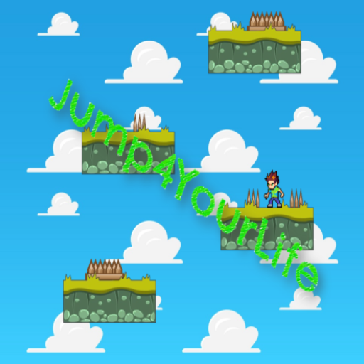

# Jump4YourLife — Android 2D Platform Game

**A 2D platform game developed in Java using Android Studio.**

Jump4YourLife is a personal Android game project originally developed in **2021**. Players control a character that moves left and right, jumps between platforms, avoids spikes and tries to reach the greatest possible height.

This repository contains the original Android source code and graphics, along with changes to the build configuration made when reopening the older project.

## Gameplay

- Move the character with the **left** and **right** on-screen buttons.
- **Jump** between platforms to reach a greater height.
- Avoid **spikes** and falling off the screen.
- Follow the **height counter** shown during the game.
- When the game ends, return to the **main menu** or open the **leaderboard**.

The graphics are drawn using Android's `Canvas` and `Bitmap` APIs inside a custom `View`. The game does not use a separate commercial game engine.

## Features

### Player registration

Before starting a game, the player enters a **nickname** and can optionally take a profile photo using the device camera. The nickname must be saved before starting.

### Local leaderboard

After a game ends, the app saves the player's nickname, optional photo and reached height in a local **SQLite** database. Saved results are displayed using a **RecyclerView**, with records loaded in descending order of height.

The leaderboard stores scores **on the device**; it is not an online ranking service.

### Android screens

The app includes a main menu, rules screen, player registration dialog, gameplay screen, leaderboard and game-over dialog.

### Additional Android components

The original source also uses **SharedPreferences** to pass temporary player/game data between screens, a **foreground notification service** while a game is running, and a **BroadcastReceiver** that displays Bluetooth status changes.

## Technology stack

| Area | Used in the project |
|---|---|
| Programming language | **Java** |
| IDE / SDK | **Android Studio, Android SDK** |
| 2D graphics | **Canvas, Bitmap, Paint, custom View** |
| Game logic | Player, Sprite, Platform, Spike, Buttons and JumpGame classes |
| Local data | **SQLite, SharedPreferences** |
| Lists | **RecyclerView** |
| App components | Activities, Intents, Service, BroadcastReceiver |
| User interface | **XML layouts** and drawable resources |

## Main Java classes

The source files are under [`app/src/main/java/com/example/jump4yourlife`](app/src/main/java/com/example/jump4yourlife).

| File | Responsibility |
|---|---|
| [JumpGame.java](app/src/main/java/com/example/jump4yourlife/JumpGame.java) | Custom game view, drawing, touch controls, falling and game-over logic |
| [Player.java](app/src/main/java/com/example/jump4yourlife/Player.java) | Character movement, jumping and platform checks |
| [Sprite.java](app/src/main/java/com/example/jump4yourlife/Sprite.java) | Shared position, image and drawing behavior for game objects |
| [Platform.java](app/src/main/java/com/example/jump4yourlife/Platform.java) | Platform object |
| [Spike.java](app/src/main/java/com/example/jump4yourlife/Spike.java) | Spike obstacle |
| [Buttons.java](app/src/main/java/com/example/jump4yourlife/Buttons.java) | Detects presses inside on-screen button areas |
| [MainActivity.java](app/src/main/java/com/example/jump4yourlife/MainActivity.java) | Main menu and player registration |
| [GameActivity.java](app/src/main/java/com/example/jump4yourlife/GameActivity.java) | Displays the game view |
| [RulesActivity.java](app/src/main/java/com/example/jump4yourlife/RulesActivity.java) | Rules screen |
| [LeaderBoardActivity.java](app/src/main/java/com/example/jump4yourlife/LeaderBoardActivity.java) | Loads and displays saved player results |
| [InformationOpenHelper.java](app/src/main/java/com/example/jump4yourlife/InformationOpenHelper.java) | SQLite database creation and operations |
| [PlayerInformation.java](app/src/main/java/com/example/jump4yourlife/PlayerInformation.java) | Player data: name, height, place and photo |
| [PlayerInformationAdapter.java](app/src/main/java/com/example/jump4yourlife/PlayerInformationAdapter.java) | Binds player information into leaderboard rows |
| [NotificationService.java](app/src/main/java/com/example/jump4yourlife/NotificationService.java) | Notification displayed during gameplay |
| [BluetootheReciver.java](app/src/main/java/com/example/jump4yourlife/BluetootheReciver.java) | Observes Bluetooth status changes |

The XML layouts are in [`app/src/main/res/layout`](app/src/main/res/layout) and the image resources are in [`app/src/main/res/drawable`](app/src/main/res/drawable).

## How to open the project

1. Clone or download this repository.
2. Open the project root in **Android Studio**.
3. Sync Gradle and install the required Android SDK packages.
4. Select an Android device or emulator, then run the **app** configuration.

### Build configuration in this repository

The game was originally written in 2021. The current checked-in build files specify:

| Setting | Value |
|---|---|
| Android Gradle Plugin | **7.1.3** |
| Gradle wrapper | **7.2** |
| Gradle runtime JDK | **JDK 11 recommended** |
| Java language compatibility | Java 8 |
| Compile SDK | **30** |
| Minimum SDK | **18** |
| Target SDK | **30** |

Recent Android Studio versions may need additional configuration to open and run the project. A clean build and complete gameplay test on the latest Android versions have **not been verified** as part of this README.

## Project background

Jump4YourLife is an **independently developed Java Android game**, documented as a school project in April 2021. This repository is kept as a portfolio example of Android programming, object-oriented design, touch handling, 2D drawing and SQLite data storage.

**Developed by Alik Minenko.**
